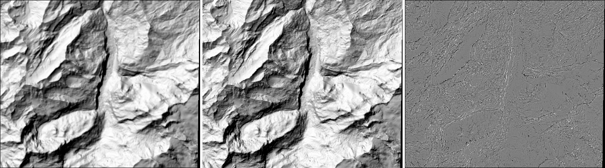

# Ray-traced hillshade vs. `gdaldem hillshade`

<!-- Generated by scripts/compare_hillshade.py; do not edit by hand. -->

Commit `d552bf4` | 2026-10-11 00:28 UTC | Intel(R) Xeon(R) Platinum 8370C CPU @ 2.80GHz (4 hardware threads) | Linux 6.17.0-1022-azure | GNU 13.3.0, Release

DEM: Copernicus GLO-30, lon 7.8..8.0, lat 46.5..46.62 (Lauterbrunnen / Jungfrau), warped to EPSG:32632 at 30 m: 517 x 437 samples, elevation 704..4093 m. Sun azimuth 315 deg, elevation 45 deg, no cast shadows (matching gdaldem).

Compared at 221789 cell centres (gdaldem averaged over the 4 surrounding samples; edges and no-data excluded).

| Metric | Value | Criterion (fixed before the first run) | Result |
|---|---|---|---|
| Pearson r | 0.9864 | >= 0.95 | pass |
| Mean difference (bsar - gdaldem) | -0.0024 | abs <= 0.02 | pass |
| Mean absolute difference | 0.0297 | reported | |
| 95th percentile absolute difference | 0.0942 | reported | |
| Correlation peak at zero shift | best shift (0, 0) | (0, 0) | pass |

Correlation for +-1 cell shifts (rows: dy, columns: dx):

| dy \ dx | -1 | 0 | +1 |
|---|---|---|---|
| -1 | 0.9285 | 0.9647 | 0.9592 |
| +0 | 0.9649 | 0.9864 | 0.9610 |
| +1 | 0.9583 | 0.9600 | 0.9217 |

Overall: **PASS**

Values are in [0, 1] (cosine of the angle between surface normal and sun). Expected differences: Horn's 3x3 operator smooths the gradient over 60 m, the ray tracer shades single 30 m triangle facets, so sharp ridges and gullies differ most.

