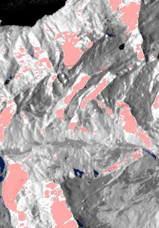
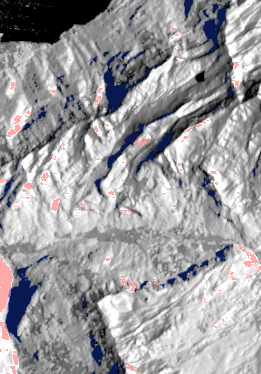

# Real-data validation pipeline

Implements the protocol in [`docs/prereg.md`](../docs/prereg.md): simulate each
0.1° tile with a real DEM and a real Sentinel-1 orbit, put simulation and real
image on one UTM 30 m grid, and compute the pre-registered metrics.

**Held-out tiles are refused** (`pipeline.check_allowed`) until `docs/prereg.md`
is marked `REGISTERED`.

## Pieces

| Module | What it does |
|---|---|
| `fetch.py` | Resumable, retrying downloads into `data/cache/` (connections that reset mid-transfer are resumed with HTTP Range) |
| `regions.py` | Tiles, 2 × 2-tile blocks, and the SHA-256-ordered calibration / held-out split (`scripts/make_split.py` prints it) |
| `prepare.py` | Copernicus GLO-30 mosaic and crop, EGM2008 → ellipsoidal heights (`h = H + N`, N read from the PROJ CDN grid), ESA WorldCover by majority resampling, UTM tile grids, ESRI ASCII grids with `.prj` |
| `pipeline.py` | `simulate_tile`: DEM crop with a 0.05° margin (outside terrain can shadow or lay over into the tile) → `bsar_render --geocode` with the real orbit and per-class materials → products on the tile's UTM grid. `compare`: every metric for one tile |
| `metrics.py` | Pure NumPy: IoU, 1-cell-tolerant F1, AUC (Mann–Whitney, ties averaged), 90 m block means, per-class Pearson r, phase-correlation offset |
| `evaluate.py` | `region-dem` (the ellipsoidal DEM for SNAP) and `run` (all tiles of a set vs. SNAP outputs, pooled as pre-registered, with pass/fail verdicts) |
| `fit.py` | Per-class `k`, `n` fit on calibration tiles: single-bounce basis renders, multi-bounce part re-rendered with the current table, interior 90 m blocks, median-absolute-dB objective; writes `materials_fitted.txt` |
| `dry_run.py` | End to end on calibration tiles with synthetic references whose answers are known, including a parameter-recovery check of the fit |
| `materials_worldcover.txt` | WorldCover class → material (starting values; only `k` and `n` may be refitted, on calibration tiles) |
| `select_scenes.py` | Applies the pre-registered scene-selection rule to the public catalogue (metadata only, no account): datatakes, footprint coverage of the region, closest to 15 August |
| `snap/s1_grd_beta0_tc.xml`, `snap/s1_grd_beta0_tc_2slices.xml` | SNAP graphs for the real-data side (orbit, noise removal, β⁰, terrain correction + layover/shadow mask); the second joins a two-slice acquisition first |
| `../data/fetch_s1.py` | Downloads the selected products with **your** CDSE account; run it yourself (credentials from environment variables or a hidden prompt, never stored or printed) |

C++ support added for this pipeline: `bsar_eval passes` (closest approaches of
a real orbit to a point, with direction, look side and incidence), and
`bsar_render --geocode --classes --material-table` (range-Doppler geocoding
onto the DEM grid, with land-cover-dependent materials).

## Usage

```bash
pip install numpy rasterio
cmake --preset release && cmake --build --preset release

# Dry run on calibration tiles (no Sentinel-1 imagery needed)
python -m validation.dry_run --build build/release

# Real data
python -m validation.select_scenes --selected build/validation/selected_scenes.json
python data/fetch_s1.py --selected build/validation/selected_scenes.json   # you, with your account
python -m validation.evaluate region-dem --out build/validation/region_dem.tif
gpt validation/snap/s1_grd_beta0_tc.xml -Pinput=data/raw/<ascending>.zip \
    -Pdem=build/validation/region_dem.tif -Poutput=build/validation/snap_asc.tif
gpt validation/snap/s1_grd_beta0_tc_2slices.xml -Pinput1=data/raw/<desc 1>.zip \
    -Pinput2=data/raw/<desc 2>.zip -Pdem=build/validation/region_dem.tif \
    -Poutput=build/validation/snap_desc.tif
python -m validation.fit \
    --asc snap_asc.tif --asc-time 2024-08-07T17:24:01 \
    --desc snap_desc.tif --desc-time 2024-08-06T05:35:49 \
    --build build/release --out build/validation/fit   # writes materials_fitted.txt
python -m validation.evaluate run --set calibration \
    --asc snap_asc.tif --asc-time 2024-08-07T17:24:01 \
    --desc snap_desc.tif --desc-time 2024-08-06T05:35:49 \
    --table build/validation/fit/materials_fitted.txt \
    --build build/release --out build/validation/calibration
# After registration: the same with --set held-out (refused before that).
```

## Status

| Piece | Status |
|---|---|
| DEM, geoid, WorldCover, UTM grids | Working; checked (geoid N = 50.5–52.7 m over the crop, matching the grid's own values) |
| Orbit download, pass finding | Working on real POEORB files; finds the S1A IW passes over the region (descending ~05:40, ascending ~17:20 UTC) |
| Simulation + geocoding per tile | Working, ~5–9 s per tile; masks tested against a closed-form ridge in `tests/test_geocode.cpp` |
| Metrics, pooling, SNAP-format loader | Working; unit tests in `validation/tests/`, plus identity and shift checks in the dry run |
| Dry run | Passes; report in [`docs/validation_dry_run.md`](../docs/validation_dry_run.md), and on every CI run |
| SNAP graphs | Run with SNAP 14.0 on both selected acquisitions, one calibration block only (`python -m validation.snap_check`). Band 1 = beta0, band 2 = mask, no band names (bands are selected by index), mask bit 1 = layover, bit 2 = shadow; confirmed against terrain slope alone, without the simulator. The two-slice graph removes thermal noise per slice before assembly (SNAP refuses the other order) |
| Per-class `k`, `n` fitting | Built (`fit.py`); recovers known parameters for forest, grassland, bare rock and water from a synthetic two-bounce image with speckle (dry run). Needs real calibration data for the actual fit |
| Real Sentinel-1 data | Downloaded with `data/fetch_s1.py` (own Copernicus Data Space account); sizes match the catalogue. Only one calibration block has been processed |

## Dry-run quicklooks

Tile N46.60 E7.90 (Lauterbrunnen), simulated beta0 on the UTM grid with layover
tinted red and shadow blue. Opposite look directions put layover and shadow on
opposite slopes.

| Ascending, 2024-08-07 17:24 UTC (incidence ~42°) | Descending, 2024-08-06 05:35 UTC (~41°) |
|---|---|
|  |  |
